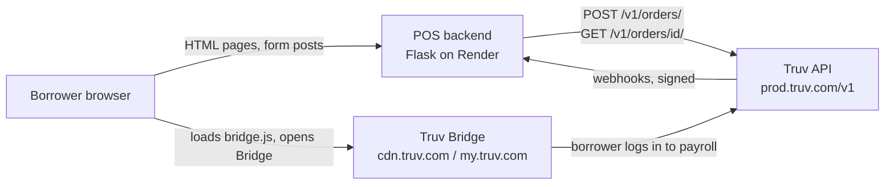
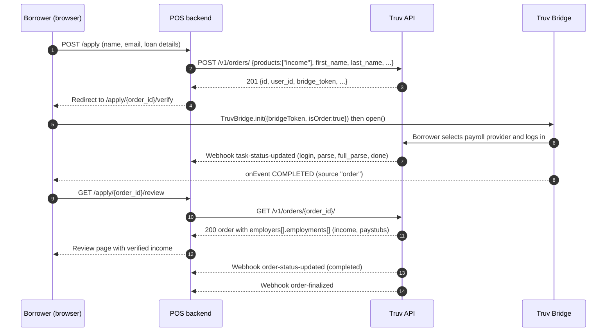

# Cedar & Stone Bank: Truv income verification in a loan application POS

This is the technical documentation for a prototype that embeds Truv income and employment
verification (VOIE) in a bank's custom loan application point-of-sale (POS). It was built as
a case study for a Truv Solutions Architect role, modeled on the Truv and nCino integration.
Cedar & Stone Bank is a fictional lender. The prototype runs against the Truv sandbox.

- Live demo: https://truv-voie-demo.onrender.com
- Quick start: see `README.md`

## Contents

1. [Goals and assumptions](#1-goals-and-assumptions)
2. [Architecture](#2-architecture)
3. [Borrower flow](#3-borrower-flow)
4. [Truv API calls in order](#4-truv-api-calls-in-order)
5. [Truv Bridge in the browser](#5-truv-bridge-in-the-browser)
6. [Webhooks](#6-webhooks)
7. [Results and the VOIE report](#7-results-and-the-voie-report)
8. [Application routes](#8-application-routes)
9. [Configuration, running and deployment](#9-configuration-running-and-deployment)
10. [Testing and QA checklist](#10-testing-and-qa-checklist)
11. [Lessons learned during the build](#11-lessons-learned-during-the-build)
12. [Production considerations](#12-production-considerations)
13. [Next steps](#13-next-steps)

---

## 1. Goals and assumptions

**Goal.** A borrower applying for a personal loan verifies income inside the bank's own
application. They don't upload paystubs and they don't leave the site. The bank receives
verified income and employment data it can underwrite on.

**Assumptions**

- **Lender POS.** The bank owns a custom web POS: frontend plus backend. Truv is added to the
  existing application flow, between "About you" and "Review and submit".
- **Embedded order.** The integration uses Truv **Orders** in embedded mode: the backend
  creates an order, and the browser opens Truv Bridge with the order's `bridge_token`.
- **One borrower, income product.** Each application has a single borrower. The order uses
  `products: ["income"]`, which also returns employment data, so VOIE is covered.
- **No Truv notifications.** The borrower verifies in-session, so Truv emails and texts are
  turned off for the order (see [section 11](#11-lessons-learned-during-the-build)).
- **Secrets stay on the server.** Truv API credentials live only on the server. The browser
  only ever sees the short-lived `bridge_token`.
- **Sandbox only.** The demo uses the Truv sandbox. The same code runs in production with
  production keys. The base URL doesn't change.

## 2. Architecture

The prototype is one always-on Flask service (Python 3.13, gunicorn) hosted on Render. The
frontend is server-rendered HTML with plain JavaScript and no build step.



**Why one service.** Webhooks arrive in their own requests, separate from the borrower's
session. With one long-running service, the webhook handler and the pages share in-memory
state, and every event shows up in one log stream. A serverless design would need an
external store for order status. That option is described in
[section 12](#12-production-considerations).

**Why Python and Flask.** It matches what many lender back-office teams run, and the backend
logic is small: two Truv API calls and one webhook endpoint. Bridge is a browser script, so
the backend language doesn't affect the borrower experience.

### End-to-end sequence



## 3. Borrower flow

| Step | Page | What happens |
| --- | --- | --- |
| 1 | `/` | Landing page for the personal loan product. |
| 2 | `/apply` | The borrower enters name, email, phone, amount ($1,000 to $50,000), term and purpose. On submit, the backend creates the Truv order. |
| 3 | `/apply/{order_id}/verify` | The "Connect my employer" button opens Truv Bridge. The page moves on only when Bridge reports `COMPLETED` from the order. |
| 4 | `/apply/{order_id}/review` | The backend fetches the order from Truv and shows the loan request, verified employer, job title, income, annual gross income and recent paystubs. |
| 5 | `/apply/{order_id}/submitted` | Confirmation that the application went to underwriting. |

Every application page has a **"Behind the scenes"** panel, for demo use only. It polls
`/apply/{order_id}/timeline` and lists the server API calls, the Bridge events the browser
reports, and the verified webhooks matched to this application.

## 4. Truv API calls in order

All calls use the base URL `https://prod.truv.com/v1/` and these headers:

```
X-Access-Client-Id: <TRUV_CLIENT_ID>
X-Access-Secret:    <TRUV_SECRET>
Content-Type:       application/json
```

Sandbox or production is decided by which keys are sent, not by the URL.

### 4.1 Register the webhook endpoint (one time, per environment)

`POST /v1/webhooks/`

```json
{
  "name": "Cedar & Stone POS (Render)",
  "webhook_url": "https://truv-voie-demo.onrender.com/webhooks/truv",
  "env_type": "sandbox",
  "events": ["task-status-updated", "order-status-updated", "order-finalized"],
  "enabled": true
}
```

This can also be done in the Truv Dashboard under Development, then Webhooks. Truv
requires an HTTPS URL.

### 4.2 Create the order (server, when the application is submitted)

`POST /v1/orders/`

```json
{
  "products": ["income"],
  "first_name": "John",
  "last_name": "Doe",
  "email": "borrower@example.com",
  "notification_settings": { "suppress_user_notifications": true }
}
```

Response `201` (abridged, from a real sandbox call):

```json
{
  "id": "82a2ff0fabc24fe3bf6045f2d17b1ca9",
  "user_id": "30435d1f55a841f08d1d4833e1e42bf9",
  "bridge_token": "1c5c9cb72e4d4ab884b682924f7b465b",
  "products": ["income"],
  "share_url": "https://my.truv.com/orders/?bridge_token=...&order_group_id=...",
  "expired_at": "2026-11-20T19:40:04.423971Z",
  "employers": [{ "id": "4b8c9c3b96fc4032b96d58333805debf", "status": "sent" }]
}
```

The backend keeps three values:

| Field | Used for |
| --- | --- |
| `id` | The order ID. Used to fetch results, and as the application key in the POS. |
| `user_id` | Matches incoming webhooks to the application. |
| `bridge_token` | Passed to the browser to open Bridge. This is the top-level token, not the per-employer one. |

Orders expire after 3 days (`expired_at`).

### 4.3 Open Bridge (browser, no API call)

See [section 5](#5-truv-bridge-in-the-browser).

### 4.4 Retrieve results (server, when the review page loads)

`GET /v1/orders/{order_id}/`

The completed order includes `completed_at`, `voie_report_id` and, under each
`employers[].employments[]`, these fields: `company`, `job_title`, `job_type`, `is_active`,
`start_date`, `income`, `income_unit`, `pay_rate`, `pay_frequency`, `statements` (paystubs)
and `annual_income_summary`.

Example from the sandbox run (`goodlogin`):

| Field | Value |
| --- | --- |
| Employer | McDonalds |
| Job title | Crew Member |
| Income | 50,330.02 (`income_unit`: YEARLY) |
| Pay frequency | BW (biweekly) |

### 4.5 VOIE report (server, for underwriting)

For orders, the report ID is already on the order (`voie_report_id`), so no report has to be
created:

```
GET /v1/users/{user_id}/reports/{voie_report_id}/            JSON
GET /v1/users/{user_id}/reports/{voie_report_id}/?fmt=pdf    PDF
```

Both calls return 200 in the sandbox run. The PDF is the document an underwriter files with
the loan.

## 5. Truv Bridge in the browser

The page loads `https://cdn.truv.com/bridge.js` and `static/verify.js`. There are no inline
scripts, so the Content Security Policy can stay strict.

```js
var bridge = TruvBridge.init({
  bridgeToken: bridgeToken,   // top-level bridge_token from the order
  isOrder: true,
  onLoad: function () {},
  onEvent: function (type, payload, source) {
    if (type === "COMPLETED" && source === "order") {
      // the only signal used to move the borrower forward
    }
  },
  onSuccess: function () {},  // per connected employer: not used to advance
  onClose: function () {}     // show "Continue verification" if not completed
});
button.disabled = false;      // enable right after init, see below
button.onclick = function () { bridge.open(); };
```

**Rules this page follows**

1. **Advance on `COMPLETED` only.** The page moves the borrower forward only on `onEvent` with
   type `COMPLETED` and source `"order"`. `onSuccess` fires per connected employer, before
   the order is done. `onClose` fires when the borrower closes Bridge, finished or not.
2. **Don't wait for `onLoad`.** With `isOrder: true`, Bridge creates its iframe only inside
   `open()`, so `onLoad` can't fire before the borrower clicks. Enable the button right after
   `init()`.
3. **Treat browser events as hints.** The browser posts each Bridge event to
   `/apply/{id}/bridge-event` for the timeline. The server never marks an application
   verified because of a browser event. It confirms by fetching the order from Truv.
4. **Allow the Truv domains in the CSP.** The response header is:

```
default-src 'self';
script-src 'self' https://cdn.truv.com;
frame-src https://my.truv.com https://cdn.truv.com https://prod.truv.com;
style-src 'self' 'unsafe-inline';
img-src 'self' data: https:;
connect-src 'self' https://*.truv.com;
font-src 'self' data:
```

**Bridge events seen in the sandbox run**, in order:

```
LOAD (order), LOAD (bridge), OPEN, SCREEN_VIEW, EMPLOYER_SELECTED, LINK_CREATED,
SCREEN_VIEW (MFA), LOGIN_COMPLETE, SUCCESS (bridge), CLOSE (bridge),
SUCCESS (order), COMPLETED (order)
```

## 6. Webhooks

### 6.1 Endpoint

`POST /webhooks/truv` on the POS backend.

### 6.2 Signature check

Truv signs each delivery in the `X-WEBHOOK-SIGN` header:

```
X-WEBHOOK-SIGN: v1=<hex HMAC-SHA256 of the raw request body, keyed with the access secret>
```

```python
raw = request.get_data()   # raw bytes, before JSON parsing
expected = "v1=" + hmac.new(TRUV_SECRET.encode(), raw, hashlib.sha256).hexdigest()
if not hmac.compare_digest(expected, request.headers.get("X-WEBHOOK-SIGN", "")):
    return 401
```

- **Raw bytes.** The HMAC is computed over the raw body. Re-serialized JSON would not match.
- **Constant-time compare.** `hmac.compare_digest` avoids timing leaks.
- **Unsigned requests are rejected** with 401. This was checked against the live service.

### 6.3 Matching and handling

Every event carries `user_id`. The handler looks up the application through a
`user_id → order_id` index built when the order was created. Events for unknown users are
kept in a short "unmatched" list instead of being dropped.

| Event | Fires when | What the POS does |
| --- | --- | --- |
| `task-status-updated` | Each connection attempt changes state: `login`, `mfa`, `parse`, `full_parse`, `done`, or an error status | Adds it to the timeline. In production, alert on error statuses. |
| `order-status-updated` | A suborder (one employer) changes status, for example to `completed` | Stores the order status. |
| `order-finalized` | The whole order is terminal. No further data collection or refresh. | Marks the order final. |

### 6.4 Observed timing (sandbox run on Render)

```
16:35:30  task-status-updated  login
16:35:30  task-status-updated  mfa
16:36:47  task-status-updated  login
16:36:50  task-status-updated  parse
16:36:51  task-status-updated  full_parse
16:36:58  task-status-updated  done
16:37:01  Bridge COMPLETED (order)           browser event
16:37:03  GET /v1/orders/{id}/ returned 200  review page
16:37:30  order-status-updated completed
16:37:30  order-finalized
```

`order-status-updated: completed` arrived about 29 seconds after Bridge reported
`COMPLETED`. The review page already had the data, because `task-status-updated: done`
came first. A POS must not block the borrower while waiting for the order-level webhook.

### 6.5 Response time

Truv's launch checklist asks endpoints to respond within 1 second. The handler only
verifies the signature, updates memory, writes a small JSON file and returns `200`. Anything
heavier, such as fetching the order, belongs in a background job.

## 7. Results and the VOIE report

`summarize_order()` in `app.py` turns the order into what a loan officer needs:

- Employer, job title, job type, active status, start and end dates.
- Income, income unit, pay rate and pay frequency.
- The six most recent paystubs: pay date, period, gross, net and hours.
- Annual gross income by year.
- Per-employer status and links to any PDF reports.

The application counts as verified when the order has employments or a `completed_at`
timestamp.

The VOIE report (section 4.5) is the system of record for underwriting. The review page is
a borrower-facing summary.

## 8. Application routes

| Method | Path | Purpose |
| --- | --- | --- |
| GET | `/` | Landing page |
| GET, POST | `/apply` | Application form. POST creates the Truv order. |
| GET | `/apply/{order_id}/verify` | Bridge page |
| POST | `/apply/{order_id}/bridge-event` | Browser reports Bridge events (timeline only) |
| GET | `/apply/{order_id}/review` | Fetches the order and shows verified income |
| POST | `/apply/{order_id}/submit` | Marks the application submitted |
| GET | `/apply/{order_id}/submitted` | Confirmation |
| GET | `/apply/{order_id}/timeline` | JSON for the "Behind the scenes" panel |
| POST | `/webhooks/truv` | Truv webhook receiver |
| GET | `/health` | Health check for Render and uptime monitoring |
| GET, POST | `/login` | Site login page (only when `DEMO_USER` and `DEMO_PASSWORD` are set) |
| POST | `/logout` | Ends the login session |
| GET | `/robots.txt` | Asks search engines not to crawl the site |

Every response gets these security headers: the CSP above, `X-Content-Type-Options: nosniff`,
`Referrer-Policy: strict-origin-when-cross-origin` and `X-Robots-Tag: noindex, nofollow`.

**Site login.** When `DEMO_USER` and `DEMO_PASSWORD` are both set, page requests without a
login go to `/login?next=<path>`, and the JavaScript routes and any POST get a 401 JSON answer.
`/webhooks/truv`, `/health`, `/robots.txt` and `/static/styles.css` stay open, so nothing
branded is shown before login. A signed session cookie
(Secure, HttpOnly, SameSite=Lax, 12 hours) keeps the visitor logged in. The cookie key is
derived from the two login settings and the Truv secret, so every server instance agrees and
changing the password logs everyone out. The login form has a CSRF token. The app uses a login
page instead of HTTP Basic Auth because the AWS Lambda Function URL renames the
`WWW-Authenticate` response header, so browsers never show the Basic Auth prompt.

## 9. Configuration, running and deployment

### Environment variables

| Name | Required | Description |
| --- | --- | --- |
| `TRUV_CLIENT_ID` | Yes | Truv client ID |
| `TRUV_SECRET` | Yes | Truv access secret. Also the webhook signing key. Never commit, log or send it to the browser. |
| `TRUV_BASE_URL` | No | Default `https://prod.truv.com/v1` |
| `BANK_NAME` | No | Default `Cedar & Stone Bank` |
| `DEMO_USER`, `DEMO_PASSWORD` | No | Site login page. Leave either empty to turn the login off. |

Locally, these are read from `.env`, which is ignored by git. `.env.example` lists the names
with empty values. On Render, they are set in the dashboard.

### Run locally

```bash
uv venv
uv pip install -r requirements.txt
cp .env.example .env        # fill in the two Truv values
.venv/bin/gunicorn app:app --workers 1 --threads 8 --bind 127.0.0.1:5050
```

Port 5000 is avoided because macOS AirPlay uses it. All Truv calls are outbound, so the full
borrower flow works locally. Only webhooks need the public deployment.

### Deploy on Render

- `render.yaml` defines one free web service. It runs
  `pip install -r requirements.txt`, then
  `gunicorn app:app --workers 1 --threads 8 --timeout 60 --bind 0.0.0.0:$PORT`, with health
  check `/health`.
- Python comes from `.python-version` (3.13).
- Pushes to `main` deploy automatically.
- Free services sleep after about 15 minutes idle and take 30 to 60 seconds to wake. An
  uptime monitor pings `/health` every 5 minutes.

### Why one worker

Application state lives in process memory, mirrored to `data/store.json`. More than one
worker would split that state. Eight threads handle concurrent requests.

## 10. Testing and QA checklist

### Sandbox credentials

In Bridge, pick any payroll provider (for example ADP) or "Truv Payroll Provider", then log
in with one of these:

| Username | Password | Scenario |
| --- | --- | --- |
| `goodlogin` | `goodpassword` | Full-time current employment. May prompt for MFA: enter `12345`. |
| `hourly.part-time` | `goodpassword` | Hourly part-time worker |
| `multiple.employments` | `goodpassword` | Multiple employers |

Truv's sandbox test credential docs list more scenarios, including login errors and locked
accounts.

**Which provider to pick.** In the sandbox every provider is simulated, so the test logins
work with any of them. The completed run in this document used ADP. Truv's docs point to
"Truv Payroll Provider" for two reasons:

- **It also works with production keys.** It is one of three test providers Truv keeps in
  production (with Truv Bank OAuth and Truv Bank non-OAuth). A bank can run test logins
  against its live configuration without billing a real applicant. Real providers such as
  ADP need real payroll accounts in production.
- **Custom scenarios can be tied to one provider.** A custom sandbox scenario that sets a
  provider only answers logins through that provider. The built-in logins above aren't
  affected.

### Quick checks

```bash
./test.sh                                                   # create order returns 201
curl https://truv-voie-demo.onrender.com/health             # {"status":"ok"}
curl -X POST https://truv-voie-demo.onrender.com/webhooks/truv -d '{}'   # 401
```

### QA checklist

| # | Scenario | Expected result | Status |
| --- | --- | --- | --- |
| 1 | Happy path with `goodlogin` | Bridge completes, page advances to review, income and paystubs shown | Passed |
| 2 | MFA prompt | Code `12345` accepted, flow continues | Passed |
| 3 | Webhooks delivered and verified | `task-status-updated` statuses, `order-status-updated: completed` and `order-finalized` in the timeline, matched by `user_id` | Passed |
| 4 | Unsigned or tampered webhook | 401, nothing stored | Passed |
| 5 | "Connect" button with `isOrder: true` | Enabled right after init, opens Bridge on click | Passed (after fix) |
| 6 | Order creation with a borrower email | Order stays `pending`, not `error` (notifications suppressed) | Passed (after fix) |
| 7 | Borrower closes Bridge before finishing | Warning shown, button changes to "Continue verification", no advance | To test |
| 8 | Bad login (sandbox error credentials) | Bridge shows the error, `task-status-updated` with an error status, no advance | To test |
| 9 | Review page opened before data is ready | "Finishing your verification" state, refresh shows data | To test |
| 10 | Expired order (over 3 days) | Clear error, new order needed | To test |
| 11 | bridge.js blocked (ad blocker or CSP) | "Verification unavailable" message | To test |
| 12 | Render cold start | First request is slow but succeeds. Webhooks retried by Truv if missed. | To test |
| 13 | Duplicate webhook delivery | Handled without side effects (idempotent) | Production item |

### Success criteria

- A borrower can go from application to verified income without leaving the bank's site
  and without uploading documents.
- The POS advances only on `COMPLETED` from the order, and confirms the data server-side.
- Every webhook is signature-verified and matched to the right application.
- Truv credentials never reach the browser, the logs or the repository.
- The underwriter can retrieve the VOIE report (JSON and PDF) by `voie_report_id`.

## 11. Lessons learned during the build

These came up while testing against the sandbox. Each is a likely pitfall for a client
integration team.

1. **Orders went to `error` right after creation.** The app sent the borrower's email on the
   order, so Truv emailed the borrower a verification link. The test address was
   undeliverable, the dashboard showed "Unable to deliver email", and the order status
   changed to Error. For embedded orders, set
   `notification_settings.suppress_user_notifications: true`. Alternatively, keep
   notifications with `first_notification_delay_hours` as a reminder for borrowers who
   leave without finishing.
2. **The Bridge button never enabled.** The page waited for `onLoad` before enabling the
   button. With `isOrder: true`, Bridge creates its iframe only in `open()`, so `onLoad`
   never fired and the borrower could never start. Enable the button right after `init()`.
3. **Order-level webhooks arrive after Bridge completes.** `order-status-updated` came
   about 29 seconds after `COMPLETED`. Don't block the borrower on it.
4. **Free hosting has an ephemeral disk.** Render's free tier wipes local files on
   restart, so applications from earlier sessions disappear. The handler also logs each
   webhook body as a single `WEBHOOK_SAMPLE` line, so payloads can be recovered from the
   logs.

## 12. Production considerations

| Area | Prototype | Production recommendation |
| --- | --- | --- |
| Storage | Memory plus a JSON file, one worker | Database table for applications, orders and webhook events. Index on `user_id` and `order_id`. |
| Webhook handling | Process inline | Verify, store the raw event, return 200 at once. Process from a queue. |
| Idempotency | Not handled | Deduplicate on `webhook_id`. Make status updates monotonic. |
| Missed webhooks | Truv retries | Also reconcile: poll `GET /v1/orders/{id}/` for orders stuck in progress. |
| Data retention | Samples on disk | Keep only what underwriting needs. Encrypt at rest. Set a retention policy. Don't log income or PII. |
| Secrets | Env vars | Secret manager, key rotation, separate sandbox and production keys |
| Monitoring | Logs | Alerts on webhook signature failures, task error statuses and order expiry |
| Hosting | One Render service | Bank's cloud or on-premises platform, more than one instance |

### Serverless option

For a client that prefers serverless, the same design splits cleanly:

- **Create-order function.** Called by the POS on application submit. Calls
  `POST /v1/orders/` and writes the order to the database.
- **Webhook function.** Verifies the signature, writes the event to the database or a queue,
  and returns 200 within the time limit.
- **Results function.** Calls `GET /v1/orders/{id}/` and the VOIE report endpoints when the
  review page or underwriting needs them.
- **Database.** Holds order status, because each function runs on its own and can't share
  memory.

The single-service prototype keeps the demo simple. The serverless layout scales and fits
platforms where the bank already runs functions.

## 13. Next steps

- **Employer search before Bridge.** Add `GET /v1/company-mappings-search/` and pass
  `company_mapping_id` (on the order, or as `companyMappingId` to Bridge) so the borrower
  lands directly on their employer.
- **VOIE PDF on the review page.** Add a server route that streams the report PDF for the
  loan officer.
- **Loan metadata on the order.** Add `loan.application_number` and `external_user_id`, so
  orders can be found by the bank's own IDs in the Truv Dashboard.
- **Co-borrowers.** Create one order per borrower on the same application.
- **Data refresh.** Re-verify before closing with `POST /v1/orders/{id}/`.
- **Rebuild application state from Truv.** If the POS loses state, rebuild the application
  from `GET /v1/orders/{id}/` so review links keep working after a restart.

## File map

```
app.py                  Routes, Truv API client, webhook handler, order summary
templates/              base, home, apply, verify, review, submitted, error, partials
static/verify.js        Bridge init and event handling
static/dev_panel.js     "Behind the scenes" timeline polling
static/apply.js, review.js, styles.css
postman/                Postman collection and environment (no secrets)
render.yaml             Render service definition
requirements.txt        Pinned Python dependencies
.python-version         3.13
.env.example            Variable names with empty values
test.sh                 curl check that creates an order
README.md               Quick start
DOCUMENTATION.md        This document
```
